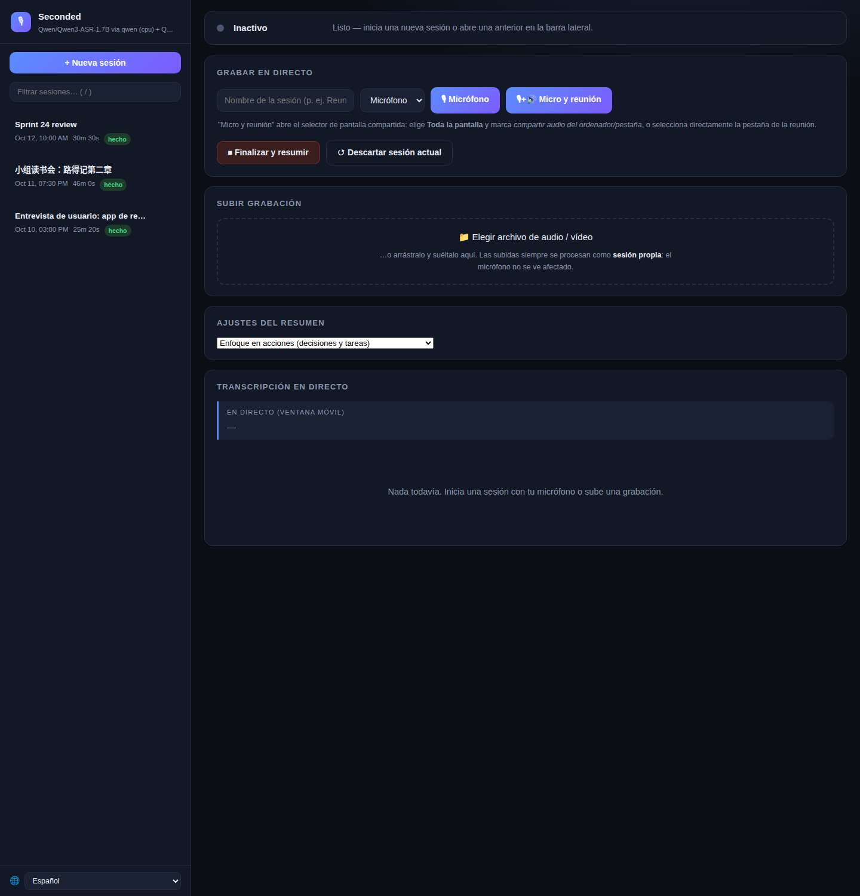
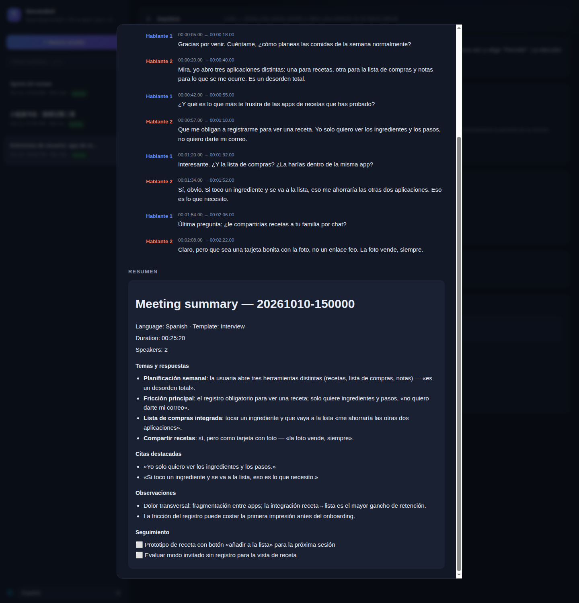

[English](README.md) · [简体中文](README.zh-CN.md) · [繁體中文](README.zh-TW.md) · **Español**

# Seconded — cada decisión, respaldada. Transcripción y resumen de reuniones en local

Un asistente de reuniones **basado en web** totalmente local: captura audio desde cualquier dispositivo en el navegador (o sube una grabación), obtén subtítulos en vivo en una página web y recibe una **transcripción con identificación de hablantes + resumen IA** en el idioma de la reunión. Sin servicios en la nube — el reconocimiento de voz (ASR) se ejecuta localmente en CPU y el resumen lo genera tu propio LLM local (cualquier API compatible con OpenAI).



Elige una plantilla de resumen por tipo de reunión; los resúmenes se muestran con decisiones, responsables y elementos de acción con casillas — y se regeneran con otra plantilla en cualquier momento, sin volver a transcribir:



## Cómo funciona
- **Captura:** micrófono del navegador (`getUserMedia`) sobre HTTPS; opcionalmente *micrófono + audio del sistema* mezclados en el navegador mediante pantalla compartida (Chrome 141+). O sube cualquier archivo de audio/vídeo.
- **ASR (intercambiable):** de forma predeterminada **Qwen3-ASR 1.7B** en CPU (~5 GB de RAM, multilingüe, marcas de tiempo por palabra con ForcedAligner) — nunca compite con tu GPU. Backend alternativo: **faster-whisper** (cualquier modelo Whisper/CT2: `large-v3`, `distil-*`, repositorios cuantizados).
- **Diariización de hablantes:** embeddings multilingües ECAPA-TDNN de SpeechBrain + agrupamiento con estimación automática del número de hablantes (no crítico; recurre a un solo hablante si falla).
- **Resumen (intercambiable):** cualquier **API local compatible con OpenAI** (LM Studio, llama.cpp, vLLM, Strata, `/v1` de Ollama, ...). Escrito en el idioma dominante de la reunión (más de 20 idiomas; ver *Idiomas* más abajo).

## Plataformas y navegadores compatibles
| | Captura de micrófono | Audio del sistema (sonido de la reunión) | Subida de archivos |
|---|---|---|---|
| **macOS + Chrome 141+** | ✅ HTTPS | ✅ pantalla compartida con "compartir audio de pestaña/ordenador" | ✅ cualquier navegador |
| **Windows + Chrome/Edge** | ✅ HTTPS | ✅ pantalla completa (marca "compartir audio") | ✅ cualquier navegador |
| **Safari / Firefox (cualquier SO)** | ✅ HTTPS | ❌ no lo admite el navegador — usa el truco de BlackHole o sube archivos | ✅ cualquier navegador |
| **iPhone / iPad (Safari)** | ✅ HTTPS | ❌ — graba con Notas de voz y sube desde el teléfono | ✅ cualquier navegador |
| **Android** | ✅ Chrome/Firefox sobre HTTPS | ❌ — igual: grabar + subir | ✅ cualquier navegador |

Notas:
- Los navegadores solo permiten capturar el micrófono sobre **HTTPS** (o `localhost`). El servidor ofrece ambos: HTTP `:8765` (subidas/descargas) y HTTPS `:8766` (captura de micrófono). Instala la CA local una vez por dispositivo desde `/rootca` para eliminar del todo el aviso del certificado.
- "Audio del sistema" significa capturar lo que *oyes* en Zoom/Meet/etc. para que ambos lados de la conversación queden en una sola grabación. Solo Chrome reciente (141+) puede hacerlo en Mac; Safari y Firefox no pueden en ninguna plataforma.

## Archivos
- `server.py` — servidor Flask: subtítulos SSE en vivo, ingesta de audio, subida de archivos (extracción de audio con ffmpeg), pipeline final, descargas por sesión (md/pdf/vtt/wav)
- `asr_engine.py` — backends ASR intercambiables: `qwen` (Qwen3-ASR + ForcedAligner) y `faster-whisper` (cualquier modelo Whisper/CT2), misma API, elegidos por variable de entorno o bandera
- `diarize.py` — diariización de hablantes (embeddings ECAPA-TDNN + agrupamiento sklearn; `--diar-backend resemblyzer` para una alternativa ligera centrada en inglés)
- `summarize.py` — generador de resúmenes para cualquier backend compatible con OpenAI: 7 plantillas, detección de idioma y reglas de idioma de salida
- `report.py` — renderizado Markdown/PDF de transcripción + resumen (fuentes seguras para CJK)
- `static/index.html` — la interfaz web (tema oscuro): subtítulos en vivo, controles de captura, subidas, historial de sesiones, descargas
- `static/i18n.js` — traducciones de la interfaz (English / 简体中文 / 繁體中文 / Español)
- `tests/` — pruebas unitarias (sin modelos): `test_summarize.py`, `test_auth.py`; `test_smoke.py` contra un servidor en marcha

## Inicio rápido
```bash
./setup.sh                        # venv + dependencias (primera ejecución: los modelos se descargan bajo demanda)
source .venv/bin/activate

# Prueba con un archivo de audio local (pipeline completo: pase final → diariización → resumen):
python server.py --file samples/sample_meeting_mixed.wav
# Los resultados se guardan en ~/.local/share/seconded/meetings/<marca-de-tiempo>/  (anulable con MEETINGS_OUTPUT_DIR)
#   transcript.txt  transcript.vtt  summary.md  audio.wav  meta.json

# Modo en vivo (lo que ejecuta el servicio systemd):
python server.py --https-port 8766
```
Requiere `ffmpeg` en el PATH para subir vídeo/audio (`.mkv`, `.mov`, `.mp3`, ...).

## Servicio permanente (systemd, opcional)
Ejecuta `seconded.service` como servicio de usuario de systemd para mantener el servidor siempre disponible en tu red local (plantilla con pasos de instalación al inicio del archivo):
```bash
systemctl --user status seconded     # estado
journalctl --user -u seconded -f     # registros
systemctl --user restart seconded    # tras cambiar el código
```
Activa el linger (`loginctl enable-linger $USER`) para que arranque con el sistema y se reinicie solo tras un fallo.

## Flujo de una reunión en vivo
Abre **https://\<ip-del-servidor\>:8766/** en un navegador — Mac, teléfono o portátil.

### Una vez por dispositivo: elimina el aviso de "riesgo de seguridad" (recomendado)
El servidor firma su certificado con una CA local (mkcert). Instálala una vez y el navegador ya no mostrará avisos:
1. Abre `https://<ip>:8766/rootca` en el mismo navegador — descarga `seconded-rootCA.pem`.
2. Añádela a tu almacén de confianza:
   - **macOS:** doble clic → Acceso a llaveros → *Confiar* → *Confiar siempre*.
   - **Windows:** Certificados → *Entidades de certificación raíz de confianza* → Importar.
   - **Android/iOS:** instala el certificado y actívalo (Ajustes → Seguridad).
3. Recarga `https://<ip>:8766/` — el aviso desaparece.

(O simplemente acepta la advertencia de certificado autofirmado una vez por dispositivo; la captura de micrófono funciona igualmente.)

### Opciones de captura
- **🎙 Micrófono** — solo tu micrófono (micrófono de sala / teléfono). Un banner ofrece "**Permitir micrófono**" de entrada (los navegadores nunca conceden acceso automático); el medidor 🎚 confirma el nivel en vivo.
- **🎙+🔊 Micro y reunión** — captura *ambas* cosas, tu voz y el sonido de la reunión, en una sola grabación: elige Pantalla completa (marca *"compartir audio del ordenador/pestaña"*) o selecciona directamente la pestaña de Zoom. Mezclado en una sola señal — ambos lados de la conversación, sin configuración extra.
- **＋ Añadir audio de reunión** — añade audio del sistema/pestaña a una sesión de solo micrófono ya iniciada, en plena reunión.

### Solución para Safari/Firefox: BlackHole (macOS)
Si tu navegador no puede compartir audio del sistema, enruta micrófono + sonido del sistema a través de dispositivos virtuales de macOS para que una sola entrada ya contenga ambos — entonces basta con **🎙 Micrófono**:
1. Instala [BlackHole](https://github.com/ExistentialAudio/BlackHole): `brew install --cask blackhole-2ch`.
2. En **Configuración de Audio MIDI**: crea un *Dispositivo de salida múltiple* (Salida integrada + BlackHole 2ch) y ponlo como salida del sistema; luego un *Dispositivo agregado* con tu entrada de micrófono + la entrada BlackHole 2ch.
3. Elige el dispositivo agregado en el desplegable de micrófonos de la interfaz web y empieza con **🎙 Micrófono**.

> Mientras el dispositivo de salida múltiple esté activo te oirás por los altavoces (normal); usa auriculares si hay realimentación. Alternativa más simple: grabar aparte y subir después.

### Durante la reunión
1. Opcional: pon nombre a la sesión; elige tu dispositivo de entrada.
2. Empieza con uno de los botones de captura anteriores.
3. Al terminar, **Finalizar y resumir**: pase final de ASR + alineador (~4× tiempo real en CPU), diariización y luego el resumen del LLM.
4. Aparecen los botones de descarga — cada tipo de contenido (Notas / Transcripción / Resumen) en **Markdown o PDF**, además de VTT y Audio WAV.

### Idiomas
La propia interfaz web está disponible en **English, 简体中文, 繁體中文 y Español** — sigue automáticamente el idioma de tu navegador y se puede cambiar en cualquier momento con el selector 🌐 al pie de la barra lateral (la elección se recuerda por navegador).

La transcripción conserva el/los idioma(s) hablados — el backend ASR los detecta en cada pase, así que una reunión mixta inglés/chino sale con ambos en su lugar. El resumen se escribe en el idioma *dominante* del habla: se respeta el idioma detectado por el ASR cuando lo reconoce (más de 20 idiomas), con detección por sistema de escritura como respaldo. El chino cuenta con un esqueleto de secciones especialmente pulido; los demás idiomas reciben la misma estructura traducida.

## Subir una grabación
Sin captura en vivo: abre **http://\<ip-del-servidor\>:8765/** y suelta un archivo sobre la tarjeta "**Subir grabación**" (o haz clic para explorar).
Funciona con cualquier audio (`.mp3`, `.m4a`, `.wav`, `.webm`…) o vídeo (`.mkv`, `.avi`, `.mov`) — ffmpeg extrae la pista de audio y ejecuta el mismo pipeline. Flujo típico con teléfono: graba con Notas de voz durante la reunión y súbelo desde el mismo teléfono después.

## Sesiones e historial
La interfaz web mantiene una barra lateral de sesiones — el trabajo en curso arriba, todo lo completado debajo.
- Cada sesión terminada se guarda en `~/.local/share/seconded/meetings/<marca-de-tiempo>/` (configurable con `MEETINGS_OUTPUT_DIR`) con un `meta.json`, por lo que sobrevive a reinicios y puede volver a descargarse en cualquier momento.
- **Nueva sesión (descartar la actual)** abandona una sesión en curso sin el pase final; las sesiones completadas nunca se tocan.
- **Renombrar / eliminar:** cada fila del historial tiene ✎ (renombrar) y 🗑 (eliminar). Eliminar pide confirmación y borra permanentemente todos los archivos de esa sesión; la sesión activa no se puede eliminar.
- **Autonombrado:** si no escribiste un nombre de sesión, el servidor la nombra con la primera frase del resumen cuando este termina.
- **Detener y descartar:** mientras se procesa (el banner muestra *Procesando…*), aparece un botón rojo **✕ Detener y descartar** en el banner — interrumpe la ejecución en su siguiente punto de control sin guardar nada.
- Los informes (transcripción/resumen, MD o PDF) incluyen una nota al pie con los tiempos de procesamiento por etapa (transcripción / separación de hablantes / resumen) y los modelos utilizados.

## Plantillas de resumen
La tarjeta **Ajustes del resumen** elige la estructura del resumen — una por tipo de reunión:
- **Enfoque en acciones** (predeterminada) — decisiones, elementos de acción con responsables, bloqueos.
- **Resumen ejecutivo** — TL;DR para dirección: resultado, logros, riesgos, decisiones pendientes.
- **Acta detallada** — registro completo: temas, decisiones con justificación, temas aparcados.
- **Grupo de discusión** — club de lectura / grupo de estudio / mesa redonda: material, puntos clave, preguntas planteadas y cómo se resolvieron, contribuciones, conclusiones, seguimiento.
- **Conferencia / seminario web / charla** — principalmente un solo ponente: esquema de puntos clave, ejemplos, preguntas y respuestas, recursos mencionados.
- **Entrevista** — candidato / invitado / investigación de usuarios: temas y respuestas en los propios términos del entrevistado, citas destacadas, observaciones, seguimiento.
- **Retrospectiva / revisión** — qué funcionó, qué no, causas raíz, acciones de mejora vinculadas a los problemas que resuelven.

La longitud del resumen está fijada en un tamaño medio razonable; cada sesión recuerda qué plantilla generó su resumen.

Pulsa **↻ Regenerar resumen** en cualquier sesión terminada (actual o del historial) para volver a generarlo con otra plantilla — sin volver a transcribir.

## Banderas del servidor (`server.py`)
| Bandera | Comportamiento | Cuándo usarla |
|---|---|---|
| *(predeterminado)* | subtítulos en vivo + pase final, un modelo ASR | quieres leer durante la reunión |
| `--no-live` | sin subtítulos en vivo; solo el pase final al terminar (lo que ejecuta el servicio) | ahorra CPU; revisarás resultados después |
| `--file X.wav` | ejecuta el pipeline sobre un archivo local y sale | pruebas |
| `--asr-backend qwen\|faster-whisper` | elige el backend ASR | predeterminado: `qwen` |
| `--asr-model ID` | id de repo HF o directorio local para el backend elegido | p. ej. `deepdml/faster-whisper-large-v3-turbo-ct2` |
| `--asr-aligner ID\|none` | backend qwen: alineador forzado para marcas de tiempo por palabra | `none` = sin marcas por palabra |
| `--asr-device cpu\|cuda` | dispositivo ASR | predeterminado: `cpu` |
| `--summary-url URL` | URL de chat-completions compatible con OpenAI | p. ej. `http://localhost:1234/v1/chat/completions` |
| `--summary-model NOMBRE` | nombre de modelo que espera el backend de resúmenes | cualquier modelo cargado |
| `--auth-token TOKEN` | exige este token en cada petición (ver *Seguridad*) | sin valor = sin autenticación (predeterminado) |

Variables de entorno equivalentes (mismos valores predeterminados): `ASR_BACKEND`, `ASR_MODEL`, `ASR_ALIGNER`, `ASR_DEVICE`, `SUMMARY_API_URL`, `SUMMARY_MODEL`, `SUMMARY_TIMEOUT`, `SUMMARIZE_MAX_TOKENS`, `SUMMARIZE_MAX_CHARS`, `SECONDED_TOKEN`.
(`LM_STUDIO_URL` / `LM_STUDIO_MODEL` / `LM_STUDIO_TIMEOUT` siguen funcionando como alias heredados.)

### Elección de modelos — ejemplos
```bash
# Predeterminado: Qwen3-ASR 1.7B (CPU) + LLM local en el puerto 8080
python server.py

# Whisper large-v3 vía faster-whisper, resumen con el 14B de LM Studio
python server.py --asr-backend faster-whisper --asr-model large-v3 \
    --summary-url http://localhost:1234/v1/chat/completions \
    --summary-model qwen3-14b

# Whisper cuantizado pequeño para una CPU modesta, sin marcas de tiempo
python server.py --asr-backend faster-whisper \
    --asr-model deepdml/faster-whisper-large-v3-turbo-ct2
```
Backends de resumen: apunta `--summary-url` a **cualquier** servidor compatible con OpenAI — LM Studio (`:1234`), llama.cpp server, vLLM, Strata, Ollama (`/v1`), etc. Cuando apunta a LM Studio (puerto 1234) el modelo fijado se carga automáticamente con `lms`; los demás backends deben tener el modelo ya residente (se lanza un error claro si no). Los modelos de razonamiento están soportados: se usa `reasoning_content` cuando `content` viene vacío.

## Rendimiento (medido con los modelos predeterminados, ASR en CPU)
| Paso | Velocidad |
|---|---|
| Pase final (Qwen3-ASR 1.7B + alineador) | ~4× tiempo real para audio corto; las reuniones largas se dividen automáticamente en trozos de ≤45 s — 2:30 de audio ≈ 30–60 s en total |
| Diariización | ~1 s por minuto de audio |
| Resumen (modelo local clase 30B IQ4 en GPU) | ~10–30 s para una reunión típica; escala con la longitud |

Nota sobre audio largo: Qwen3-ASR se degrada silenciosamente por encima de ~70 s por llamada, así que el backend qwen siempre divide la entrada larga en fronteras de baja energía y vuelve a unir las marcas de tiempo al tiempo global. faster-whisper gestiona audio largo de forma nativa (filtrado VAD, sin divisiones).

## Notas / limitaciones conocidas
- **El pase final es en lo que debes confiar**; los subtítulos en vivo son una vista previa de ventana móvil.
- La calidad de la diariización depende de la separación del audio; el habla superpuesta puede etiquetarse mal. Las reuniones de un solo hablante son trivialmente correctas.
- El generador de resúmenes habla con el backend en `SUMMARY_API_URL` (ver *Elección de modelos* arriba).
- Los modelos se almacenan en caché en `~/.cache/huggingface/` tras la primera descarga.

## Seguridad — lee antes de exponerlo
Seconded funciona **sin autenticación de forma predeterminada** — en tu propia red local de confianza eso es justo lo deseado: abre la página y graba. Si otros pueden acceder a tu red, activa un token de acceso compartido:

```bash
python server.py --auth-token "$(openssl rand -hex 16)"   # o: export SECONDED_TOKEN=***
```

Con un token definido, cada petición lo necesita: los navegadores ven una página de inicio de sesión con estilo (la cookie dura 30 días); los scripts pueden pasar `X-Seconded-Token: ***`, `Authorization: Bearer *** o `?token=*** (para SSE). Los tokens incorrectos devuelven 401; las comparaciones son de tiempo constante. Para systemd, añade `Environment=SECONDED_TOKEN=...` a la unidad del servicio.

Ten en cuenta que el servidor escucha en `0.0.0.0` (necesario para otros dispositivos de tu red local). Incluso con token, prefiere un túnel (WireGuard, Tailscale) antes que reenviar puertos a internet. La CA raíz autofirmada se genera por instalación y nunca sale de tu máquina.

## Licencia
Seconded se licencia bajo la **GNU Affero General Public License v3.0** (ver [LICENSE](LICENSE)). Eres libre de usar, estudiar, modificar y distribuir Seconded — incluido el uso comercial — siempre que lo mantengas abierto: cualquier versión modificada, incluida la que se ofrezca como servicio de red, debe publicarse bajo la misma licencia con su código fuente disponible y el aviso de copyright original intacto. Los archivos `samples/*.wav` incluidos son audio sintético (síntesis de voz) generado para este repositorio y se distribuyen bajo los mismos términos.
