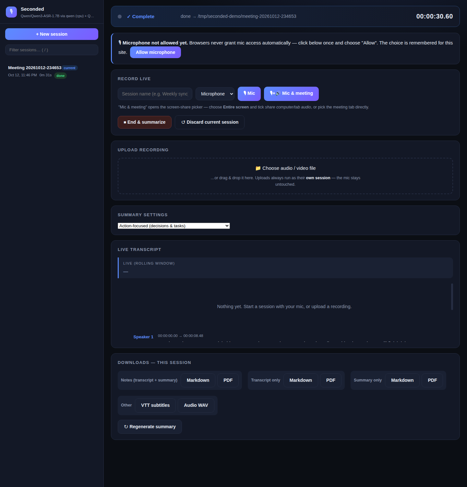
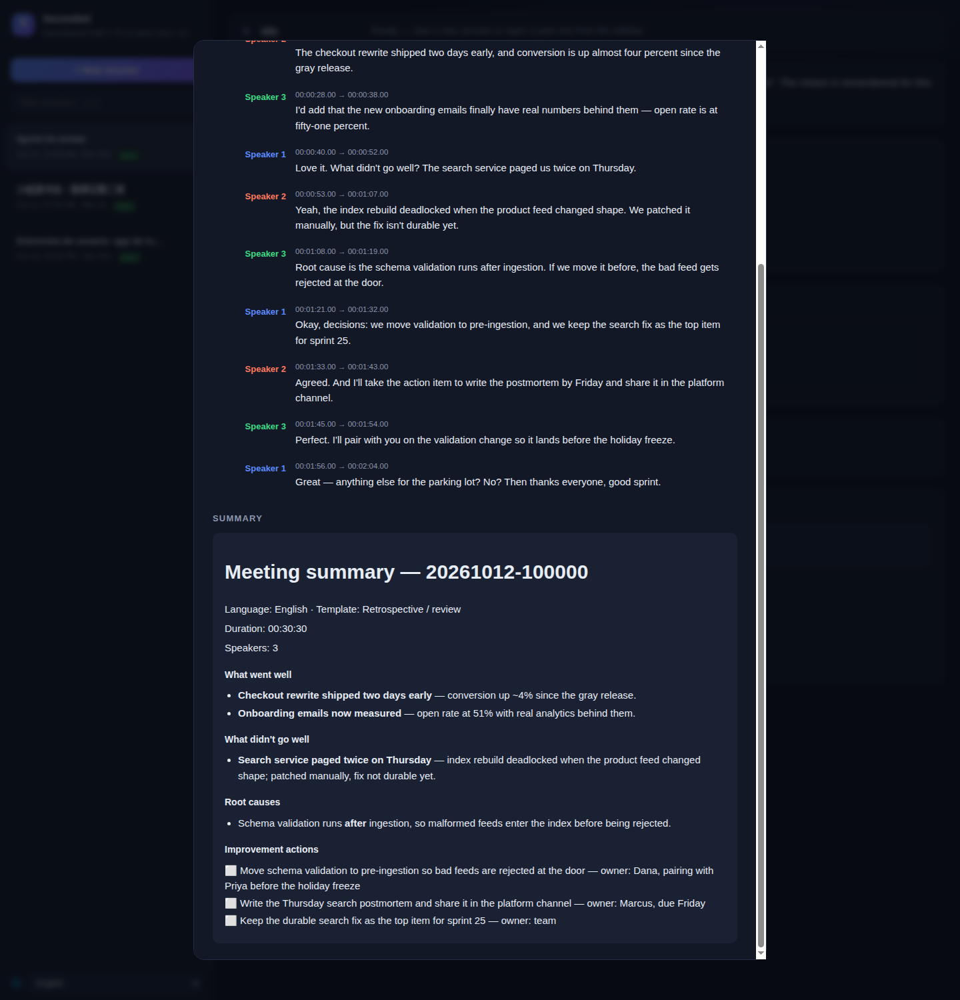

**English** · [简体中文](README.zh-CN.md) · [繁體中文](README.zh-TW.md) · [Español](README.es.md)

# Seconded — every decision, seconded. Local meeting transcription & summarization

A fully-local, **web-based** meeting assistant: capture audio from any device in the
browser (or upload a recording), get live subtitles on a web page, then receive a
**diarized transcript + AI summary** in the language of the meeting. No cloud services —
ASR runs locally on CPU and summarization uses your own local LLM (any OpenAI-compatible API).



Pick a summary template per meeting type; summaries render with decisions, owners and
checkbox action items — and regenerate with another template anytime, no re-transcription:



## How it works
- **Capture:** browser mic (`getUserMedia`) over HTTPS; optionally *mic + system audio*
  mixed in-browser via screen share (Chrome 141+). Or upload any audio/video file.
- **ASR (pluggable):** default **Qwen3-ASR 1.7B** on CPU (~5 GB RAM, multilingual,
  word timestamps via ForcedAligner) — never fights your GPU. Alternative backend:
  **faster-whisper** (any Whisper/CT2 model: `large-v3`, `distil-*`, quantized repos).
  Transcription runs **incrementally during the meeting** (blocks of ~45 s, each
  transcribed once and reused as live subtitles), so after a long meeting you wait
  only for the last block + diarization + summary instead of the whole recording.
- **Diarization:** silero voice-activity gating + SpeechBrain ECAPA-TDNN multilingual
  speaker embeddings + clustering with automatic speaker-count estimation
  (non-fatal; falls back to a single speaker).
- **Summary (pluggable):** any **OpenAI-compatible local API** (LM Studio, llama.cpp,
  vLLM, Strata, Ollama's `/v1`, ...). Written in the dominant spoken language
  (20+ languages; see *Languages* below).

## Platform & browser support
| | Mic capture | System audio (meeting sound) | Upload files |
|---|---|---|---|
| **macOS + Chrome 141+** | ✅ HTTPS | ✅ screen share with "share tab/computer audio" | ✅ any browser |
| **Windows + Chrome/Edge** | ✅ HTTPS | ✅ whole-screen share (tick "share audio") | ✅ any browser |
| **Safari / Firefox (any OS)** | ✅ HTTPS | ❌ not supported by the browser — use BlackHole workaround or upload | ✅ any browser |
| **iPhone / iPad (Safari)** | ✅ HTTPS | ❌ — record with voice memos, then upload from the phone | ✅ any browser |
| **Android** | ✅ Chrome/Firefox over HTTPS | ❌ — same: record + upload | ✅ any browser |

Notes:
- Browsers only allow microphone capture over **HTTPS** (or `localhost`). The server runs
  both: HTTP `:8765` (uploads/downloads) and HTTPS `:8766` (mic capture). Install the local
  CA once per device via `/rootca` to remove the cert warning entirely.
- "System audio" means capturing what you *hear* in Zoom/Meet/etc. so both sides of the
  conversation end up in one recording. Only recent Chrome can do it on Mac (141+); Safari
  and Firefox cannot, on any platform.

## Files
- `server.py` — Flask server: SSE live subtitles, stream ingest, file upload (ffmpeg audio
  extraction), final pipeline, per-session downloads (md/pdf/vtt/wav)
- `asr_engine.py` — pluggable ASR backends: `qwen` (Qwen3-ASR + ForcedAligner) and
  `faster-whisper` (any Whisper/CT2 model), same API, selected by env var or flag
- `diarize.py` — speaker diarization (ECAPA-TDNN embeddings + sklearn clustering;
  `--diar-backend resemblyzer` for a lighter English-centric fallback)
- `summarize.py` — summarizer for any OpenAI-compatible backend: 7 templates,
  language detection & output-language rules
- `report.py` — Markdown/PDF rendering of transcript + summary (CJK-safe fonts)
- `static/index.html` — the web UI (dark theme): live subtitles, capture controls, uploads,
  session history, downloads
- `static/i18n.js` — UI translations (English / 简体中文 / 繁體中文 / Español)
- `tests/` — unit tests (no models needed): `test_summarize.py`, `test_auth.py`;
  `test_smoke.py` hits a running server

## Quick start
```bash
./setup.sh                        # venv + deps (first run: models download on demand)
source .venv/bin/activate

# Test with a local audio file (full pipeline: final pass → diarize → summary):
python server.py --file samples/sample_meeting_mixed.wav
# Artifacts land in ~/.local/share/seconded/meetings/<timestamp>/  (override: MEETINGS_OUTPUT_DIR)
#   transcript.txt  transcript.vtt  summary.md  audio.wav  meta.json

# Live mode (what the systemd service runs):
python server.py --https-port 8766
```
Requires `ffmpeg` on PATH for video/audio upload (`.mkv`, `.mov`, `.mp3`, ...).

## Always-on service (systemd, optional)
Run `seconded.service` as a systemd user service to keep the server
always available on your LAN (template with install steps at the top of the file):
```bash
systemctl --user status seconded     # check
journalctl --user -u seconded -f     # logs
systemctl --user restart seconded    # after code changes
```
Enable linger (`loginctl enable-linger $USER`) so it starts at boot and auto-restarts on crash.

## Live meeting workflow
Open **https://\<server-ip\>:8766/** in a browser — Mac, phone, or laptop.

### One-time per device: stop the "security risk" warning (recommended)
The server signs its certificate with a local CA (mkcert). Install it once and the browser
shows no warning afterwards:
1. Open `https://<ip>:8766/rootca` in the same browser — downloads `seconded-rootCA.pem`.
2. Add it to your trusted store:
   - **macOS:** double-click → Keychain Access → *Trust* → *Always Trust*.
   - **Windows:** Certificates → *Trusted Root Certification Authorities* → Import.
   - **Android/iOS:** install the cert, then enable it (Settings → Security).
3. Reload `https://<ip>:8766/` — the warning is gone.

(Otherwise just accept the self-signed warning once per device; mic capture still works.)

### Capture options
- **🎙 Mic** — your microphone only (room mic / phone). A banner offers **"Allow
  microphone"** up front (browsers never auto-grant); the 🎚 meter confirms live level.
- **🎙+🔊 Mic & meeting audio** — captures *both* your voice and the meeting's sound in one
  recording: choose Entire screen (tick *"share computer/tab audio"*) or pick the Zoom tab
  directly. Mixed into a single stream — both sides of the conversation, no extra setup.
- **＋ Add meeting audio** — add system/tab audio to a running Mic-only session mid-meeting.

### Safari/Firefox workaround: BlackHole (macOS)
If your browser can't share system audio, route mic + system sound through macOS virtual
devices so one input already contains both — then plain **🎙 Mic** is all you need:
1. Install [BlackHole](https://github.com/ExistentialAudio/BlackHole): `brew install --cask blackhole-2ch`.
2. In **Audio MIDI Setup**: create a *Multi-Output Device* (Built-in Output + BlackHole 2ch)
   and set it as system output; then an *Aggregate Device* with your microphone input +
   BlackHole 2ch input.
3. Pick the Aggregate device in the web UI's mic dropdown, start with **🎙 Mic**.

> While Multi-Output is active you'll hear yourself through speakers (normal); use headphones
> if feedback becomes an issue. Simplest alternative: record separately and upload afterwards.

### Running a meeting
1. Optionally set a session name; pick your input device.
2. Start with one of the capture buttons above.
3. When done, **End & summarize**: the tail of the ASR (most was transcribed during
   the meeting), diarization, then the LLM summary.
4. Download buttons appear — each content type (Notes / Transcript / Summary) as
   **Markdown or PDF**, plus VTT and Audio WAV.

### Languages
The web interface itself is available in **English, 简体中文, 繁體中文 and Español** —
it follows your browser language automatically and can be switched anytime with the
🌐 selector at the bottom of the sidebar (the choice is remembered per browser).

The transcript keeps whatever language(s) were spoken — the ASR backend detects them per
pass, so a mixed English/Chinese meeting comes out with both in place. The summary is
written in the *dominant* spoken language: the ASR-detected language is honored when
recognized (20+ languages), with script-based detection as fallback. Chinese gets a
hand-tuned section skeleton; other languages get the same structure translated.

## Uploading a recording
No live capture needed: open **http://\<server-ip\>:8765/** and drop a file onto the
**"Upload recording"** card (or click to browse).
Any audio (`.mp3`, `.m4a`, `.wav`, `.webm`…) or video (`.mkv`, `.avi`, `.mov`) works — ffmpeg
extracts the audio track, then the same pipeline runs. Typical phone workflow: record with
voice memos during the meeting, upload from the same phone afterwards.

## Sessions & history
The web UI keeps a sidebar of sessions — current live work on top, everything completed below.
- Each finished session is saved to `~/.local/share/seconded/meetings/<timestamp>/`
  (configurable via `MEETINGS_OUTPUT_DIR`) with a `meta.json`, so it survives restarts
  and can be re-downloaded anytime.
- **New session (discard current)** abandons an in-progress session without the final pass;
  completed sessions are never touched.
- **Rename / delete:** each History row has ✎ (rename) and 🗑 (delete). Delete asks for
  confirmation and permanently removes all of that session's files; the currently active
  session can't be deleted.
- **Auto-naming:** if you didn't type a session name, the server names it from the first
  sentence of the summary once that finishes.
- **Stop & discard:** while processing (banner shows *Processing…*), a red **✕ Stop & discard**
  button appears in the banner — it aborts the run at its next checkpoint and saves nothing.
- Reports (transcript/summary, MD or PDF) include a footer note with per-stage processing
  times (transcription / speaker separation / summary) and which models were used.

## Summary templates
The **Summary settings** card picks the structure of the summary — one per meeting type:
- **Action-focused** (default) — decisions, action items with owners, blockers.
- **Executive brief** — TL;DR for leadership: outcome, results, risks, decisions needed.
- **Detailed minutes** — full record: topics, decisions with rationale, parking lot.
- **Discussion group** — book club / study group / round table: material, key points,
  questions raised & where they landed, contributions, takeaways, follow-ups.
- **Lecture / webinar / talk** — mostly one speaker: outline of key points, examples,
  Q&A, resources mentioned.
- **Interview** — candidate / guest / user research: topics & answers in the subject's
  own terms, notable quotes, observations, follow-ups.
- **Retrospective / review** — what went well, what didn't, root causes, improvement
  action items mapped to the problems they fix.

Summary length is fixed at a sensible medium; each session remembers which template
produced its summary.

Click **↻ Regenerate summary** on any finished session (current or in History) to re-run with
a different template — no re-transcription.

## Server flags (`server.py`)
| Flag | Behavior | When to use |
|---|---|---|
| *(default)* | live subtitles + incremental transcription during the meeting | normal use — shortest wait after the meeting |
| `--no-incremental` | no work during the meeting; transcribe everything after it ends | weak/loaded CPU during the meeting |
| `--no-live` | no live subtitles and no incremental work; only the final pass at end | saves all CPU during the meeting |
| `--file X.wav` | run the pipeline on a local file and exit | testing |
| `--asr-backend qwen\|faster-whisper` | choose the ASR backend | default: `qwen` |
| `--asr-model ID` | HF repo id or local dir for the chosen backend | e.g. `deepdml/faster-whisper-large-v3-turbo-ct2` |
| `--asr-aligner ID\|none` | qwen backend: forced aligner for word timestamps | `none` = no word timestamps |
| `--asr-device cpu\|cuda` | ASR device | default: `cpu` |
| `--summary-url URL` | OpenAI-compatible chat-completions URL | e.g. `http://localhost:1234/v1/chat/completions` |
| `--summary-model NAME` | model name the summary backend expects | any loaded model |
| `--auth-token TOKEN` | require this token on every request (see *Security*) | unset = no auth (default) |

Equivalent env vars (same defaults): `ASR_BACKEND`, `ASR_MODEL`, `ASR_ALIGNER`,
`ASR_DEVICE`, `SUMMARY_API_URL`, `SUMMARY_MODEL`, `SUMMARY_TIMEOUT`,
`SUMMARIZE_MAX_TOKENS`, `SUMMARIZE_MAX_CHARS`, `SECONDED_TOKEN`.
(`LM_STUDIO_URL` / `LM_STUDIO_MODEL` / `LM_STUDIO_TIMEOUT` still work as legacy aliases.)

### Choosing models — examples
```bash
# Default: Qwen3-ASR 1.7B (CPU) + local LLM on port 8080
python server.py

# Whisper large-v3 via faster-whisper, summary from LM Studio's 14B
python server.py --asr-backend faster-whisper --asr-model large-v3 \
    --summary-url http://localhost:1234/v1/chat/completions \
    --summary-model qwen3-14b

# Small quantized whisper for a weak CPU, timestamps off
python server.py --asr-backend faster-whisper \
    --asr-model deepdml/faster-whisper-large-v3-turbo-ct2
```
Summary backends: point `--summary-url` at **any** OpenAI-compatible server —
LM Studio (`:1234`), llama.cpp server, vLLM, Strata, Ollama (`/v1`), etc. When
pointed at LM Studio (port 1234) the pinned model is auto-loaded via `lms`;
other backends must already have the model resident (a clear error is raised
if not). Reasoning models are handled: `reasoning_content` is used when
`content` comes back empty.

## Performance (measured on default models, CPU ASR)
| Step | Speed |
|---|---|
| Transcription (Qwen3-ASR 1.7B + aligner) | ~1.1× realtime on a 12-core CPU, but it runs **during** the meeting in 45 s blocks — post-meeting wait is only the unprocessed tail |
| Diarization | ~1 s per minute of audio |
| Summary (local 30B-class IQ4 model on GPU) | ~10–30 s for a typical meeting; scales with length |

An 84-minute meeting previously needed ~95 min of post-meeting transcription; with
incremental transcription the same meeting finishes seconds after the last block is
transcribed (plus diarization + summary). Long audio is auto-chunked into ≤45 s pieces —
Qwen3-ASR silently degrades past ~70 s in one call, so the qwen backend always splits
longer input at low-energy boundaries and merges word timestamps back to global time.
faster-whisper handles long audio natively (VAD-filtered, no splitting).

## Notes / known limits
- Live subtitles **are** the real transcript: each block is transcribed once and reused
  by the final pass (no separate lower-quality preview pass anymore).
- Diarization quality depends on audio separation; overlapping speech can mislabel.
  Single-speaker meetings are trivially correct.
- The summarizer talks to the backend at `SUMMARY_API_URL` (see *Choosing models* above).
- Models are cached in `~/.cache/huggingface/` after first download.

## Security — read before exposing it
Seconded runs **without authentication by default** — on your own trusted LAN that's
the point: open the page and record. If others can reach your network, enable a shared
access token:

```bash
python server.py --auth-token "$(openssl rand -hex 16)"   # or: export SECONDED_TOKEN=***
```

With a token set, every request needs it: browsers get a styled login page (the cookie
persists 30 days); scripts can pass `X-Seconded-Token: ***`, `Authorization: Bearer …`,
or `?token=*** (for SSE). Wrong tokens get 401; comparisons are constant-time.
For systemd, add `Environment=SECONDED_TOKEN=...` to the service unit.

Note the server binds `0.0.0.0` (needed for other devices on your LAN). Even with a
token, prefer tunneling (WireGuard, Tailscale) over port-forwarding to the internet.
The self-signed root CA is generated per-install and never leaves your machine.

## License
Seconded is licensed under the **GNU Affero General Public License v3.0**
(see [LICENSE](LICENSE)). You are free to use, study, modify, and distribute
Seconded — including commercially — as long as you keep it open: any modified
version, including one offered as a network service, must be published under
the same license with its source available and the original copyright notice
intact. The bundled `samples/*.wav` files are synthetic (text-to-speech) audio
generated for this repository and are distributed under the same terms.
