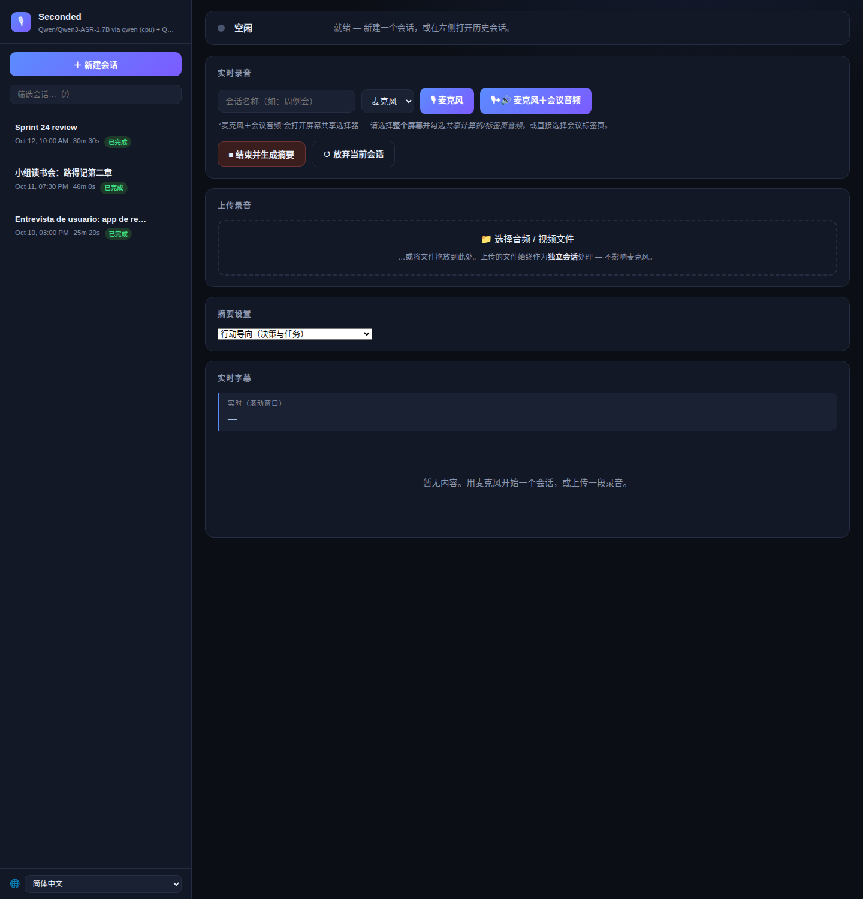
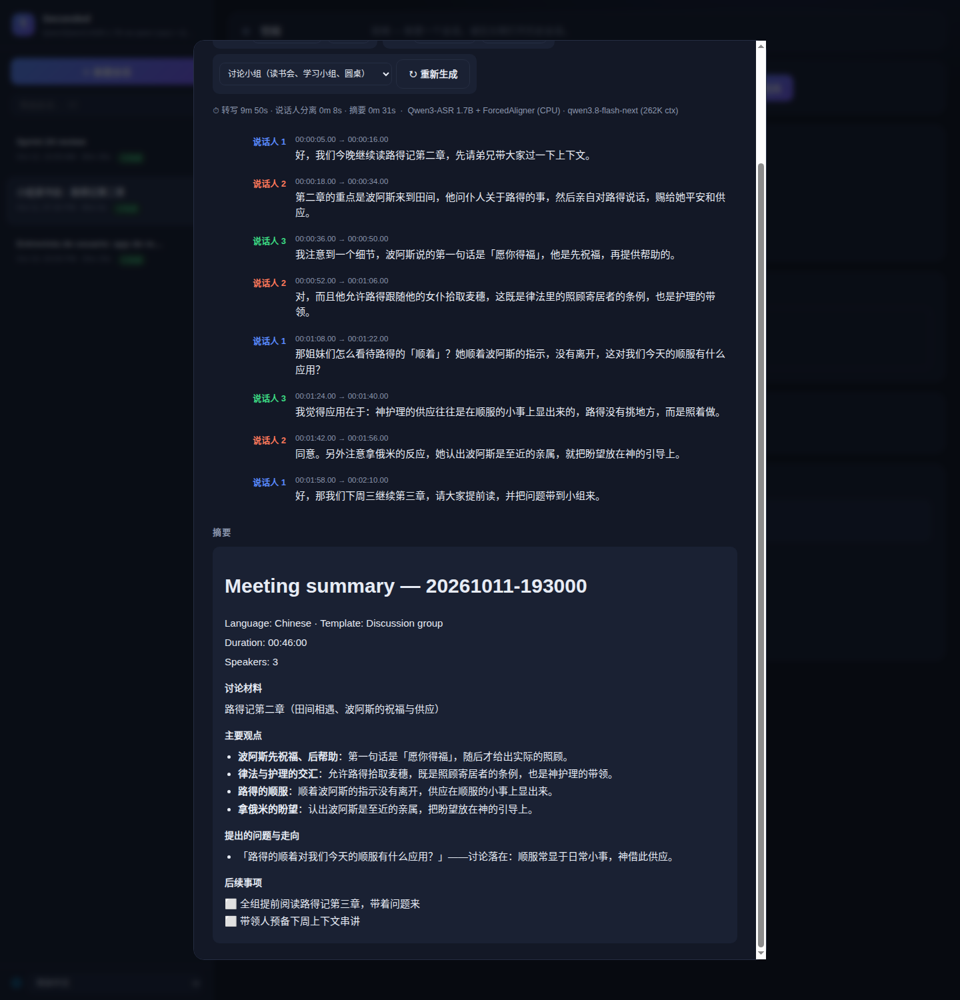

**English** · [简体中文](README.zh-CN.md) · [繁體中文](README.zh-TW.md) · [Español](README.es.md)

# Seconded — 每个决定，都有人附议。本地会议转写与摘要

完全本地化的**网页版**会议助手：在浏览器中从任意设备采集音频（或上传录音），在网页上获得实时字幕，然后收到**按说话人区分的转写文本 + AI 摘要**，语言与会议语言一致。不依赖任何云服务 — 语音识别在本地 CPU 上运行，摘要由你自己的本地大模型生成（任何 OpenAI 兼容 API）。



按会议类型选择摘要模板；摘要会呈现决议、负责人和带复选框的行动项 — 随时可用其他模板重新生成，无需重新转写：



## 工作原理
- **采集：** 通过 HTTPS 使用浏览器麦克风（`getUserMedia`）；还可通过屏幕共享在浏览器内混合*麦克风 + 系统音频*（Chrome 141+）。或上传任意音频/视频文件。
- **语音识别（可插拔）：** 默认 **Qwen3-ASR 1.7B** 运行于 CPU（约 5 GB 内存，多语言，通过 ForcedAligner 提供单词级时间戳）— 不占用你的 GPU。备选后端：**faster-whisper**（任意 Whisper/CT2 模型：`large-v3`、`distil-*`、量化仓库）。
- **说话人分离：** resemblyzer 声纹嵌入 + 凝聚聚类（非致命；失败时回退为单一说话人）。
- **摘要（可插拔）：** 任何 **OpenAI 兼容本地 API**（LM Studio、llama.cpp、vLLM、Strata、Ollama 的 `/v1` 等）。以会议的主导语言撰写（20+ 种语言；见下文*语言*）。

## 平台与浏览器支持
| | 麦克风采集 | 系统音频（会议声音） | 上传文件 |
|---|---|---|---|
| **macOS + Chrome 141+** | ✅ HTTPS | ✅ 屏幕共享并勾选“共享标签页/电脑音频” | ✅ 任意浏览器 |
| **Windows + Chrome/Edge** | ✅ HTTPS | ✅ 共享整个屏幕（勾选“共享音频”） | ✅ 任意浏览器 |
| **Safari / Firefox（任意系统）** | ✅ HTTPS | ❌ 浏览器不支持 — 使用 BlackHole 方案或上传 | ✅ 任意浏览器 |
| **iPhone / iPad（Safari）** | ✅ HTTPS | ❌ — 用语音备忘录录音，然后从手机上传 | ✅ 任意浏览器 |
| **Android** | ✅ Chrome/Firefox（HTTPS） | ❌ — 同上：录音 + 上传 | ✅ 任意浏览器 |

说明：
- 浏览器只允许在 **HTTPS**（或 `localhost`）下使用麦克风。服务器两者都提供：HTTP `:8765`（上传/下载）和 HTTPS `:8766`（麦克风采集）。每台设备通过 `/rootca` 安装一次本地 CA，即可彻底消除证书警告。
- “系统音频”指采集你在 Zoom/Meet 等会议中*听到*的声音，让对话双方进入同一段录音。只有较新的 Chrome（141+）能在 Mac 上实现；Safari 和 Firefox 在任何平台都不行。

## 文件说明
- `server.py` — Flask 服务器：SSE 实时字幕、音频流接收、文件上传（ffmpeg 提取音频）、最终处理管线、按会话下载（md/pdf/vtt/wav）
- `asr_engine.py` — 可插拔 ASR 后端：`qwen`（Qwen3-ASR + ForcedAligner）和 `faster-whisper`（任意 Whisper/CT2 模型），API 相同，通过环境变量或命令行参数选择
- `diarize.py` — 说话人分离（resemblyzer + sklearn 聚类）
- `summarize.py` — 面向任意 OpenAI 兼容后端的摘要器：7 种模板、语言检测与输出语言规则
- `report.py` — 转写 + 摘要的 Markdown/PDF 渲染（CJK 字体安全）
- `static/index.html` — 网页界面（深色主题）：实时字幕、采集控制、上传、会话历史、下载
- `static/i18n.js` — 界面翻译（英语 / 简体中文 / 繁體中文 / Español）
- `tests/` — 单元测试（无需模型）：`test_summarize.py`、`test_auth.py`；`test_smoke.py` 针对运行中的服务器

## 快速开始
```bash
./setup.sh                        # 创建 venv + 安装依赖（首次运行：模型按需下载）
source .venv/bin/activate

# 用本地音频文件测试（完整管线：最终转写 → 说话人分离 → 摘要）：
python server.py --file samples/sample_meeting_mixed.wav
# 产物位于 ~/.local/share/seconded/meetings/<时间戳>/（可用 MEETINGS_OUTPUT_DIR 覆盖）
#   transcript.txt  transcript.vtt  summary.md  audio.wav  meta.json

# 实时模式（systemd 服务的运行方式）：
python server.py --https-port 8766
```
上传视频/音频（`.mkv`、`.mov`、`.mp3` 等）需要 PATH 中安装 `ffmpeg`。

## 常驻服务（systemd，可选）
将 `seconded.service` 配置为 systemd 用户服务，让服务器在局域网内始终可用（安装步骤见文件顶部注释）：
```bash
systemctl --user status seconded     # 查看状态
journalctl --user -u seconded -f     # 日志
systemctl --user restart seconded    # 修改代码后重启
```
启用 linger（`loginctl enable-linger $USER`）可在开机时自动启动、崩溃后自动重启。

## 实时会议流程
在浏览器中打开 **https://\<服务器IP\>:8766/** — Mac、手机或笔记本均可。

### 每台设备一次性操作：消除“安全风险”警告（推荐）
服务器使用本地 CA（mkcert）签发证书。安装一次后浏览器不再显示警告：
1. 在同一浏览器打开 `https://<ip>:8766/rootca` — 下载 `seconded-rootCA.pem`。
2. 添加到受信任的证书存储：
   - **macOS：** 双击 → 钥匙串访问 → *信任* → *始终信任*。
   - **Windows：** 证书 → *受信任的根证书颁发机构* → 导入。
   - **Android/iOS：** 安装证书后启用（设置 → 安全）。
3. 重新加载 `https://<ip>:8766/` — 警告消失。

（也可以每台设备手动接受一次自签名警告；麦克风采集不受影响。）

### 采集选项
- **🎙 麦克风** — 仅使用你的麦克风（会议室麦克风 / 手机）。页面顶部会提示“**允许麦克风**”（浏览器从不自动授权）；🎚 电平表确认实时音量。
- **🎙+🔊 麦克风＋会议音频** — 在一次录音中同时采集*你的声音*和*会议的声音*：选择整个屏幕（勾选*“共享电脑/标签页音频”*）或直接选择 Zoom 标签页。混合为单一音频流 — 对话双方尽在掌握，无需额外设置。
- **＋ 添加会议音频** — 在仅麦克风的会话进行中，随时加入系统/标签页音频。

### Safari/Firefox 替代方案：BlackHole（macOS）
如果你的浏览器无法共享系统音频，可通过 macOS 虚拟设备把麦克风和系统声音路由到同一输入 — 之后只需普通的 **🎙 麦克风**：
1. 安装 [BlackHole](https://github.com/ExistentialAudio/BlackHole)：`brew install --cask blackhole-2ch`。
2. 在**音频 MIDI 设置**中：创建*多输出设备*（内置输出 + BlackHole 2ch）并设为系统输出；再创建*聚合设备*，包含麦克风输入 + BlackHole 2ch 输入。
3. 在网页界面的麦克风下拉框中选择聚合设备，用 **🎙 麦克风** 开始。

> 多输出设备启用期间你会从扬声器听到自己的声音（正常现象）；如有回声请使用耳机。最简单的替代方案：分开录音，会后上传。

### 进行会议
1. 可选：设置会话名称；选择输入设备。
2. 用上述任一采集按钮开始。
3. 结束后点击**结束并生成摘要**：最终 ASR 转写 + 对齐（CPU 约 4 倍实时速度）、说话人分离，然后是大模型摘要。
4. 出现下载按钮 — 每类内容（笔记 / 字幕 / 摘要）均可下载 **Markdown 或 PDF**，另有 VTT 和音频 WAV。

### 语言
网页界面本身支持**英语、简体中文、繁體中文和 Español** — 自动跟随浏览器语言，也可随时通过侧边栏底部的 🌐 选择器切换（每个浏览器记住你的选择）。

转写文本保留实际使用的语言 — ASR 后端逐段检测，因此中英混合的会议两种语言都会原样保留。摘要以*主导*口语语言撰写：优先采用 ASR 检测到的语言（20+ 种），无法识别时按文字系统回退检测。中文有专门打磨过的章节骨架；其他语言获得同样结构的翻译版本。

## 上传录音
无需实时采集：打开 **http://\<服务器IP\>:8765/**，把文件拖到**“上传录音”**卡片上（或点击选择）。
支持任意音频（`.mp3`、`.m4a`、`.wav`、`.webm`…）或视频（`.mkv`、`.avi`、`.mov`）— ffmpeg 提取音频轨道后运行同一管线。典型手机工作流：会议中用语音备忘录录音，会后从同一部手机上传。

## 会话与历史
网页界面在侧边栏保留会话列表 — 当前进行中的在最上方，已完成的在下方。
- 每个已完成的会话保存在 `~/.local/share/seconded/meetings/<时间戳>/`（可通过 `MEETINGS_OUTPUT_DIR` 配置），含 `meta.json`，重启后依然可查、可随时重新下载。
- **新建会话（放弃当前）** 会放弃进行中的会话且不执行最终转写；已完成的会话永不受影响。
- **重命名 / 删除：** 每条历史都有 ✎（重命名）和 🗑（删除）。删除需要确认，并永久移除该会话的所有文件；当前活动会话无法删除。
- **自动命名：** 如果你没有输入会话名称，服务器会在摘要完成后用摘要的第一句话命名。
- **停止并放弃：** 处理期间（横幅显示*处理中…*），横幅中会出现红色 **✕ 停止并放弃** 按钮 — 在下一个检查点中止本次运行，不保存任何内容。
- 报告（转写/摘要，MD 或 PDF）页脚附有各阶段处理时间（转写 / 说话人分离 / 摘要）和所用模型的说明。

## 摘要模板
**摘要设置**卡片决定摘要的结构 — 每种会议类型一个模板：
- **行动导向**（默认）— 决议、带负责人的行动项、阻碍。
- **高管简报** — 面向领导层的 TL;DR：结果、成绩、风险、待决策事项。
- **详细会议纪要** — 完整记录：议题、附理由的决议、待议清单。
- **讨论小组** — 读书会 / 学习小组 / 圆桌：讨论材料、要点、提出的问题及走向、发言贡献、收获、后续事项。
- **讲座 / 网络研讨会 / 演讲** — 以单人为主：要点大纲、示例、问答、提及的资源。
- **访谈** — 候选人 / 嘉宾 / 用户调研：按受访者自己的表述整理话题与回答、金句、观察、后续事项。
- **回顾 / 复盘** — 哪些做得好、哪些不好、根本原因、与问题对应的改进行动项。

摘要长度固定为合理的中等篇幅；每个会话都会记住其摘要由哪个模板生成。

对任何已完成的会话（当前会话或历史记录中）点击 **↻ 重新生成摘要**，即可换用其他模板重跑 — 无需重新转写。

## 服务器参数（`server.py`）
| 参数 | 行为 | 适用场景 |
|---|---|---|
| *（默认）* | 实时字幕 + 最终转写，单个 ASR 模型 | 会议中想边听边看 |
| `--no-live` | 无实时字幕；仅在结束时执行最终转写（服务的运行方式） | 节省 CPU；会后再看结果 |
| `--file X.wav` | 对本地文件运行管线后退出 | 测试 |
| `--asr-backend qwen\|faster-whisper` | 选择 ASR 后端 | 默认：`qwen` |
| `--asr-model ID` | 所选后端的 HF 仓库 id 或本地目录 | 例如 `deepdml/faster-whisper-large-v3-turbo-ct2` |
| `--asr-aligner ID\|none` | qwen 后端：用于单词时间戳的强制对齐器 | `none` = 无单词时间戳 |
| `--asr-device cpu\|cuda` | ASR 设备 | 默认：`cpu` |
| `--summary-url URL` | OpenAI 兼容 chat-completions 地址 | 例如 `http://localhost:1234/v1/chat/completions` |
| `--summary-model NAME` | 摘要后端期望的模型名 | 任意已加载模型 |
| `--auth-token TOKEN` | 每个请求都需要此令牌（见*安全*） | 不设置 = 无认证（默认） |

等效环境变量（默认值相同）：`ASR_BACKEND`、`ASR_MODEL`、`ASR_ALIGNER`、`ASR_DEVICE`、`SUMMARY_API_URL`、`SUMMARY_MODEL`、`SUMMARY_TIMEOUT`、`SUMMARIZE_MAX_TOKENS`、`SUMMARIZE_MAX_CHARS`、`SECONDED_TOKEN`。
（`LM_STUDIO_URL` / `LM_STUDIO_MODEL` / `LM_STUDIO_TIMEOUT` 仍作为旧版别名可用。）

### 模型选择 — 示例
```bash
# 默认：Qwen3-ASR 1.7B（CPU）+ 8080 端口的本地大模型
python server.py

# 通过 faster-whisper 使用 Whisper large-v3，摘要用 LM Studio 的 14B
python server.py --asr-backend faster-whisper --asr-model large-v3 \
    --summary-url http://localhost:1234/v1/chat/completions \
    --summary-model qwen3-14b

# 性能较弱的 CPU 使用小型量化 whisper，关闭时间戳
python server.py --asr-backend faster-whisper \
    --asr-model deepdml/faster-whisper-large-v3-turbo-ct2
```
摘要后端：将 `--summary-url` 指向**任意** OpenAI 兼容服务器 — LM Studio（`:1234`）、llama.cpp server、vLLM、Strata、Ollama（`/v1`）等。指向 LM Studio（1234 端口）时会通过 `lms` 自动加载指定模型；其他后端需保证模型已常驻（未加载时会给出清晰报错）。支持推理模型：`content` 为空时使用 `reasoning_content`。

## 性能（默认模型、CPU ASR 实测）
| 步骤 | 速度 |
|---|---|
| 最终转写（Qwen3-ASR 1.7B + 对齐器） | 短音频约 4 倍实时；长会议自动切分为 ≤45 秒片段 — 2 分 30 秒音频 ≈ 30–60 秒总耗时 |
| 说话人分离 | 每分钟音频约 1 秒 |
| 摘要（GPU 上本地 30B 级 IQ4 模型） | 典型会议约 10–30 秒；随长度增长 |

长音频说明：Qwen3-ASR 单次调用超过约 70 秒会静默退化，因此 qwen 后端总是在低能量边界切分长音频，并把单词时间戳合并回全局时间。faster-whisper 原生支持长音频（VAD 过滤，无需切分）。

## 说明 / 已知限制
- **请以最终转写为准**；实时字幕只是滚动窗口的预览。
- 说话人分离质量取决于音频分离程度；重叠发言可能标错。单人会议天然准确。
- 摘要器通过 `SUMMARY_API_URL` 指向的后端工作（见上文*模型选择*）。
- 模型首次下载后缓存在 `~/.cache/huggingface/`。

## 安全 — 暴露前必读
Seconded 默认**不启用认证** — 在你自己的可信局域网里这正是设计初衷：打开页面就能录音。如果你的网络可被他人访问，请启用共享访问令牌：

```bash
python server.py --auth-token "$(openssl rand -hex 16)"   # 或：export SECONDED_TOKEN=***
```

设置令牌后，每个请求都必须携带：浏览器会看到样式化的登录页（cookie 保持 30 天）；脚本可传 `X-Seconded-Token: ***`、`Authorization: Bearer *** 或 `?token=***（用于 SSE）。错误令牌返回 401；比较采用恒定时间算法。systemd 可在服务单元中添加 `Environment=SECONDED_TOKEN=...`。

注意服务器绑定 `0.0.0.0`（局域网其他设备需要）。即使有令牌，也建议用隧道（WireGuard、Tailscale）而不是向互联网端口转发。自签名根 CA 每次安装独立生成，永不离开你的机器。

## 许可证
Seconded 采用 **GNU Affero General Public License v3.0**（见 [LICENSE](LICENSE)）。你可以自由使用、研究、修改和分发 Seconded — 包括商业用途 — 但必须保持开源：任何修改版本（包括作为网络服务提供的版本）都必须以相同许可证发布、公开源代码，并保留原始版权声明。仓库自带的 `samples/*.wav` 是为本项目生成的合成（文本转语音）音频，采用相同条款分发。
