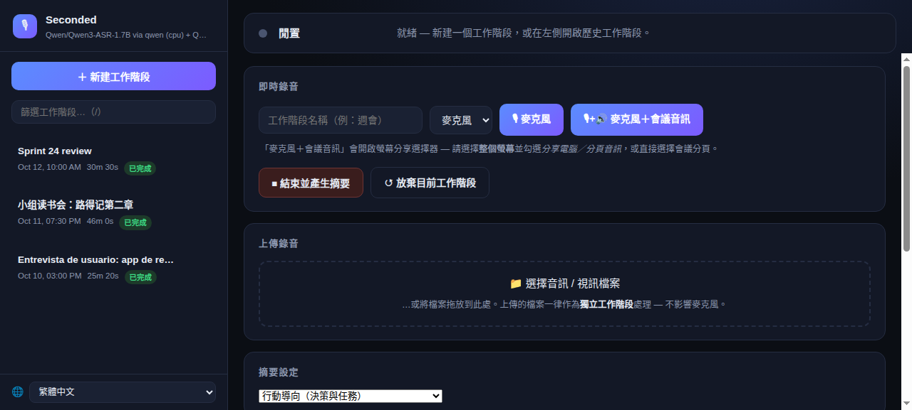
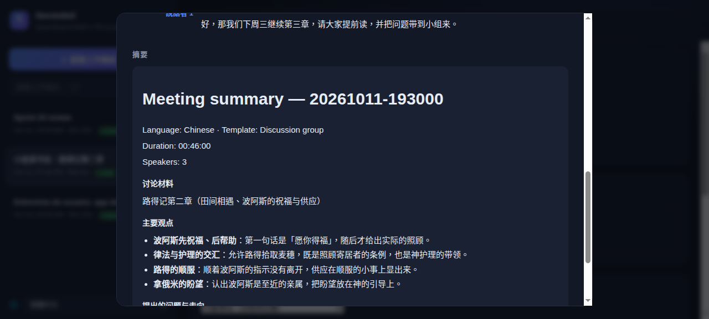

[English](README.md) · [简体中文](README.zh-CN.md) · **繁體中文** · [Español](README.es.md)

# Seconded — 每個決定，都有人附議。本地會議轉錄與摘要

完全本地化的**網頁版**會議助理：在瀏覽器中從任何裝置擷取音訊（或上傳錄音），在網頁上獲得即時字幕，然後收到**依說話者區分的轉錄文字 + AI 摘要**，語言與會議語言一致。不依賴任何雲端服務 — 語音辨識在本地 CPU 上執行，摘要由您自己的本地大型語言模型產生（任何 OpenAI 相容 API）。



依會議類型選擇摘要範本；摘要會呈現決議、負責人與帶核取方塊的行動項目 — 隨時可換用其他範本重新產生，無需重新轉錄：



## 運作原理
- **擷取：** 透過 HTTPS 使用瀏覽器麥克風（`getUserMedia`）；亦可透過螢幕分享在瀏覽器內混合*麥克風 + 系統音訊*（Chrome 141+）。或上傳任何音訊/視訊檔案。
- **語音辨識（可插拔）：** 預設 **Qwen3-ASR 1.7B** 執行於 CPU（約 5 GB 記憶體，多語言，透過 ForcedAligner 提供單字級時間戳）— 不佔用您的 GPU。備選後端：**faster-whisper**（任何 Whisper/CT2 模型：`large-v3`、`distil-*`、量化倉庫）。
- **說話者分離：** silero 語音活動偵測 + SpeechBrain ECAPA-TDNN 多語言聲紋嵌入 + 自動估計說話者數量的聚類（非致命；失敗時回退為單一說話者）。
- **摘要（可插拔）：** 任何 **OpenAI 相容本地 API**（LM Studio、llama.cpp、vLLM、Strata、Ollama 的 `/v1` 等）。以會議的主導語言撰寫（20+ 種語言；見下文*語言*）。

## 平台與瀏覽器支援
| | 麥克風擷取 | 系統音訊（會議聲音） | 上傳檔案 |
|---|---|---|---|
| **macOS + Chrome 141+** | ✅ HTTPS | ✅ 螢幕分享並勾選「分享分頁/電腦音訊」 | ✅ 任何瀏覽器 |
| **Windows + Chrome/Edge** | ✅ HTTPS | ✅ 分享整個螢幕（勾選「分享音訊」） | ✅ 任何瀏覽器 |
| **Safari / Firefox（任何系統）** | ✅ HTTPS | ❌ 瀏覽器不支援 — 使用 BlackHole 方案或上傳 | ✅ 任何瀏覽器 |
| **iPhone / iPad（Safari）** | ✅ HTTPS | ❌ — 用語音備忘錄錄音，然後從手機上傳 | ✅ 任何瀏覽器 |
| **Android** | ✅ Chrome/Firefox（HTTPS） | ❌ — 同上：錄音 + 上傳 | ✅ 任何瀏覽器 |

說明：
- 瀏覽器只允許在 **HTTPS**（或 `localhost`）下使用麥克風。伺服器兩者都提供：HTTP `:8765`（上傳/下載）與 HTTPS `:8766`（麥克風擷取）。每台裝置透過 `/rootca` 安裝一次本地 CA，即可徹底消除憑證警告。
- 「系統音訊」指擷取您在 Zoom/Meet 等會議中*聽到*的聲音，讓對話雙方進入同一段錄音。只有較新的 Chrome（141+）能在 Mac 上實現；Safari 和 Firefox 在任何平台都不行。

## 檔案說明
- `server.py` — Flask 伺服器：SSE 即時字幕、音訊串流接收、檔案上傳（ffmpeg 擷取音訊）、最終處理管線、依工作階段下載（md/pdf/vtt/wav）
- `asr_engine.py` — 可插拔 ASR 後端：`qwen`（Qwen3-ASR + ForcedAligner）與 `faster-whisper`（任何 Whisper/CT2 模型），API 相同，透過環境變數或命令列參數選擇
- `diarize.py` — 說話者分離（ECAPA-TDNN 嵌入 + sklearn 聚類；可用 `--diar-backend resemblyzer` 切換為更輕量的英語後備方案）
- `summarize.py` — 面向任何 OpenAI 相容後端的摘要器：7 種範本、語言偵測與輸出語言規則
- `report.py` — 轉錄 + 摘要的 Markdown/PDF 渲染（CJK 字型安全）
- `static/index.html` — 網頁介面（深色主題）：即時字幕、擷取控制、上傳、工作階段歷史、下載
- `static/i18n.js` — 介面翻譯（英文 / 简体中文 / 繁體中文 / Español）
- `tests/` — 單元測試（無需模型）：`test_summarize.py`、`test_auth.py`；`test_smoke.py` 針對執行中的伺服器

## 快速開始
```bash
./setup.sh                        # 建立 venv + 安裝相依套件（首次執行：模型依需求下載）
source .venv/bin/activate

# 用本地音訊檔案測試（完整管線：最終轉錄 → 說話者分離 → 摘要）：
python server.py --file samples/sample_meeting_mixed.wav
# 產物位於 ~/.local/share/seconded/meetings/<時間戳>/（可用 MEETINGS_OUTPUT_DIR 覆寫）
#   transcript.txt  transcript.vtt  summary.md  audio.wav  meta.json

# 即時模式（systemd 服務的執行方式）：
python server.py --https-port 8766
```
上傳視訊/音訊（`.mkv`、`.mov`、`.mp3` 等）需要 PATH 中安裝 `ffmpeg`。

## 常駐服務（systemd，選配）
將 `seconded.service` 設定為 systemd 使用者服務，讓伺服器在區域網路內隨時可用（安裝步驟見檔案頂端註解）：
```bash
systemctl --user status seconded     # 檢視狀態
journalctl --user -u seconded -f     # 記錄
systemctl --user restart seconded    # 修改程式碼後重新啟動
```
啟用 linger（`loginctl enable-linger $USER`）可在開機時自動啟動、當機後自動重啟。

## 即時會議流程
在瀏覽器中開啟 **https://\<伺服器IP\>:8766/** — Mac、手機或筆電皆可。

### 每台裝置一次性操作：消除「安全性風險」警告（建議）
伺服器使用本地 CA（mkcert）簽發憑證。安裝一次後瀏覽器不再顯示警告：
1. 在同一瀏覽器開啟 `https://<ip>:8766/rootca` — 下載 `seconded-rootCA.pem`。
2. 加入受信任的憑證儲存區：
   - **macOS：** 雙擊 → 鑰匙串存取 → *信任* → *一律信任*。
   - **Windows：** 憑證 → *受信任的根憑證授權單位* → 匯入。
   - **Android/iOS：** 安裝憑證後啟用（設定 → 安全性）。
3. 重新載入 `https://<ip>:8766/` — 警告消失。

（也可以每台裝置手動接受一次自簽名警告；麥克風擷取不受影響。）

### 擷取選項
- **🎙 麥克風** — 僅使用您的麥克風（會議室麥克風 / 手機）。頁面頂部會提示「**允許麥克風**」（瀏覽器從不自動授權）；🎚 音量表確認即時音量。
- **🎙+🔊 麥克風＋會議音訊** — 在一次錄音中同時擷取*您的聲音*和*會議的聲音*：選擇整個螢幕（勾選*「分享電腦/分頁音訊」*）或直接選擇 Zoom 分頁。混合為單一音訊串流 — 對話雙方盡在掌握，無需額外設定。
- **＋ 新增會議音訊** — 在僅麥克風的工作階段進行中，隨時加入系統/分頁音訊。

### Safari/Firefox 替代方案：BlackHole（macOS）
如果您的瀏覽器無法分享系統音訊，可透過 macOS 虛擬裝置把麥克風和系統聲音路由到同一輸入 — 之後只需普通的 **🎙 麥克風**：
1. 安裝 [BlackHole](https://github.com/ExistentialAudio/BlackHole)：`brew install --cask blackhole-2ch`。
2. 在**音訊 MIDI 設定**中：建立*多輸出裝置*（內建輸出 + BlackHole 2ch）並設為系統輸出；再建立*聚合裝置*，包含麥克風輸入 + BlackHole 2ch 輸入。
3. 在網頁介面的麥克風下拉式選單中選擇聚合裝置，用 **🎙 麥克風** 開始。

> 多輸出裝置啟用期間您會從揚聲器聽到自己的聲音（正常現象）；如有回聲請使用耳機。最簡單的替代方案：分開錄音，會後上傳。

### 進行會議
1. 可選：設定工作階段名稱；選擇輸入裝置。
2. 用上述任一擷取按鈕開始。
3. 結束後點擊**結束並產生摘要**：最終 ASR 轉錄 + 對齊（CPU 約 4 倍即時速度）、說話者分離，然後是大型語言模型摘要。
4. 出現下載按鈕 — 每類內容（筆記 / 字幕 / 摘要）均可下載 **Markdown 或 PDF**，另有 VTT 與音訊 WAV。

### 語言
網頁介面本身支援**英文、简体中文、繁體中文和 Español** — 自動跟隨瀏覽器語言，也可隨時透過側邊欄底部的 🌐 選擇器切換（每個瀏覽器記住您的選擇）。

轉錄文字保留實際使用的語言 — ASR 後端逐段偵測，因此中英混合的會議兩種語言都會原樣保留。摘要以*主導*口語語言撰寫：優先採用 ASR 偵測到的語言（20+ 種），無法辨識時依文字系統回退偵測。中文有專門打磨過的章節骨架；其他語言獲得同樣結構的翻譯版本。

## 上傳錄音
無需即時擷取：開啟 **http://\<伺服器IP\>:8765/**，把檔案拖到**「上傳錄音」**卡片上（或點擊選擇）。
支援任何音訊（`.mp3`、`.m4a`、`.wav`、`.webm`…）或視訊（`.mkv`、`.avi`、`.mov`）— ffmpeg 擷取音訊軌道後執行同一管線。典型手機工作流：會議中用語音備忘錄錄音，會後從同一支手機上傳。

## 工作階段與歷史
網頁介面在側邊欄保留工作階段清單 — 目前進行中的在最上方，已完成的在下方。
- 每個已完成的工作階段保存在 `~/.local/share/seconded/meetings/<時間戳>/`（可透過 `MEETINGS_OUTPUT_DIR` 設定），含 `meta.json`，重新啟動後依然可查、可隨時重新下載。
- **新建工作階段（放棄目前）** 會放棄進行中的工作階段且不執行最終轉錄；已完成的工作階段永不受影響。
- **重新命名 / 刪除：** 每筆歷史都有 ✎（重新命名）和 🗑（刪除）。刪除需要確認，並永久移除該工作階段的所有檔案；目前活動中的工作階段無法刪除。
- **自動命名：** 如果您沒有輸入工作階段名稱，伺服器會在摘要完成後用摘要的第一句話命名。
- **停止並放棄：** 處理期間（橫幅顯示*處理中…*），橫幅中會出現紅色 **✕ 停止並放棄** 按鈕 — 在下一個檢查點中止本次執行，不儲存任何內容。
- 報告（轉錄/摘要，MD 或 PDF）頁尾附有各階段處理時間（轉錄 / 說話者分離 / 摘要）和所用模型的說明。

## 摘要範本
**摘要設定**卡片決定摘要的結構 — 每種會議類型一個範本：
- **行動導向**（預設）— 決議、負責人的行動項目、阻礙。
- **高管簡報** — 針對領導層的 TL;DR：結果、成績、風險、待決策事項。
- **詳細會議紀錄** — 完整記錄：議題、附理由的決議、待議清單。
- **討論小組** — 讀書會 / 學習小組 / 圓桌：討論材料、要點、提出的問題及走向、發言貢獻、收穫、後續事項。
- **講座 / 網路研討會 / 演講** — 以單人為主：要點大綱、範例、問答、提及的資源。
- **訪談** — 候選人 / 來賓 / 使用者研究：依受訪者自己的表述整理話題與回答、金句、觀察、後續事項。
- **回顧 / 複盤** — 哪些做得好、哪些不好、根本原因、與問題對應的改進行動項目。

摘要長度固定為合理的中等篇幅；每個工作階段都會記住其摘要由哪個範本產生。

對任何已完成的工作階段（目前工作階段或歷史記錄中）點擊 **↻ 重新產生摘要**，即可換用其他範本重跑 — 無需重新轉錄。

## 伺服器參數（`server.py`）
| 參數 | 行為 | 適用場景 |
|---|---|---|
| *（預設）* | 即時字幕 + 最終轉錄，單一 ASR 模型 | 會議中想邊聽邊看 |
| `--no-live` | 無即時字幕；僅在結束時執行最終轉錄（服務的執行方式） | 節省 CPU；會後再看結果 |
| `--file X.wav` | 對本地檔案執行管線後結束 | 測試 |
| `--asr-backend qwen\|faster-whisper` | 選擇 ASR 後端 | 預設：`qwen` |
| `--asr-model ID` | 所選後端的 HF 倉庫 id 或本地目錄 | 例如 `deepdml/faster-whisper-large-v3-turbo-ct2` |
| `--asr-aligner ID\|none` | qwen 後端：用於單字時間戳的強制對齊器 | `none` = 無單字時間戳 |
| `--asr-device cpu\|cuda` | ASR 裝置 | 預設：`cpu` |
| `--summary-url URL` | OpenAI 相容 chat-completions 網址 | 例如 `http://localhost:1234/v1/chat/completions` |
| `--summary-model NAME` | 摘要後端期望的模型名 | 任何已載入模型 |
| `--auth-token TOKEN` | 每個請求都需要此令牌（見*安全性*） | 未設定 = 無認證（預設） |

等效環境變數（預設值相同）：`ASR_BACKEND`、`ASR_MODEL`、`ASR_ALIGNER`、`ASR_DEVICE`、`SUMMARY_API_URL`、`SUMMARY_MODEL`、`SUMMARY_TIMEOUT`、`SUMMARIZE_MAX_TOKENS`、`SUMMARIZE_MAX_CHARS`、`SECONDED_TOKEN`。
（`LM_STUDIO_URL` / `LM_STUDIO_MODEL` / `LM_STUDIO_TIMEOUT` 仍作為舊版別名可用。）

### 模型選擇 — 範例
```bash
# 預設：Qwen3-ASR 1.7B（CPU）+ 8080 連接埠的本地大型語言模型
python server.py

# 透過 faster-whisper 使用 Whisper large-v3，摘要用 LM Studio 的 14B
python server.py --asr-backend faster-whisper --asr-model large-v3 \
    --summary-url http://localhost:1234/v1/chat/completions \
    --summary-model qwen3-14b

# 效能較弱的 CPU 使用小型量化 whisper，關閉時間戳
python server.py --asr-backend faster-whisper \
    --asr-model deepdml/faster-whisper-large-v3-turbo-ct2
```
摘要後端：將 `--summary-url` 指向**任何** OpenAI 相容伺服器 — LM Studio（`:1234`）、llama.cpp server、vLLM、Strata、Ollama（`/v1`）等。指向 LM Studio（1234 連接埠）時會透過 `lms` 自動載入指定模型；其他後端需確保模型已常駐（未載入時會給出清晰錯誤訊息）。支援推理模型：`content` 為空時使用 `reasoning_content`。

## 效能（預設模型、CPU ASR 實測）
| 步驟 | 速度 |
|---|---|
| 最終轉錄（Qwen3-ASR 1.7B + 對齊器） | 短音訊約 4 倍即時；長會議自動切分為 ≤45 秒片段 — 2 分 30 秒音訊 ≈ 30–60 秒總耗時 |
| 說話者分離 | 每分鐘音訊約 1 秒 |
| 摘要（GPU 上本地 30B 級 IQ4 模型） | 典型會議約 10–30 秒；隨長度增長 |

長音訊說明：Qwen3-ASR 單次呼叫超過約 70 秒會靜默退化，因此 qwen 後端總是在低能量邊界切分長音訊，並把單字時間戳合併回全域時間。faster-whisper 原生支援長音訊（VAD 過濾，無需切分）。

## 說明 / 已知限制
- **請以最終轉錄為準**；即時字幕只是視窗滾動的預覽。
- 說話者分離品質取決於音訊分離程度；重疊發言可能標錯。單一說話者會議天然準確。
- 摘要器透過 `SUMMARY_API_URL` 指向的後端運作（見上文*模型選擇*）。
- 模型首次下載後快取於 `~/.cache/huggingface/`。

## 安全性 — 暴露前必讀
Seconded 預設**不啟用認證** — 在您自己的可信區域網路裡這正是設計初衷：開啟頁面就能錄音。如果您的網路可被他人存取，請啟用共用存取令牌：

```bash
python server.py --auth-token "$(openssl rand -hex 16)"   # 或：export SECONDED_TOKEN=***
```

設定令牌後，每個請求都必須攜帶：瀏覽器會看到樣式化的登入頁（cookie 保持 30 天）；腳本可傳 `X-Seconded-Token: ***`、`Authorization: Bearer *** 或 `?token=***（用於 SSE）。錯誤令牌回傳 401；比較採用固定時間演算法。systemd 可在服務單元中加入 `Environment=SECONDED_TOKEN=...`。

注意伺服器綁定 `0.0.0.0`（區域網路其他裝置需要）。即使有令牌，也建議使用隧道（WireGuard、Tailscale）而不是對網際網路連接埠轉送。自簽名根 CA 每次安裝獨立產生，永不離開您的裝置。

## 授權條款
Seconded 採用 **GNU Affero General Public License v3.0**（見 [LICENSE](LICENSE)）。您可以自由使用、研究、修改和分發 Seconded — 包括商業用途 — 但必須保持開源：任何修改版本（包括作為網路服務提供的版本）都必須以相同授權條款發布、公開原始程式碼，並保留原始版權聲明。倉庫自帶的 `samples/*.wav` 是為本專案產生的合成（文字轉語音）音訊，採用相同條款分發。
